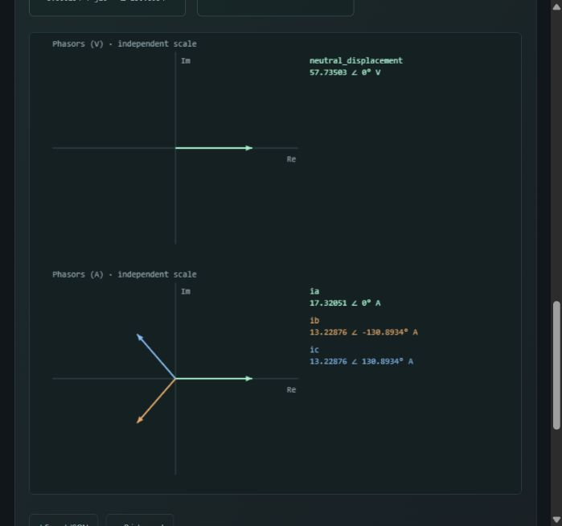

# PowerCalcs

**Electrical engineering calculations with transparent equations, dimension-checked inputs, and reproducible study records.**

[](https://github.com/VictorOdoyo/powercalcs/actions/workflows/ci.yml)
[](https://www.python.org/)
[](LICENSE)

PowerCalcs is a reusable Python library, JSON CLI, and local browser workbench for power systems engineers. It includes **50 calculators**, **30 unit families**, complex RMS phasors, ABC symmetrical components, unbalanced star/delta loads, and analytical reference cases. Runtime uses the Python standard library only.



## Start

```sh
git clone https://github.com/VictorOdoyo/powercalcs.git
cd powercalcs
python -m venv .venv
# Windows PowerShell:
.venv\Scripts\Activate.ps1
# Linux/macOS: source .venv/bin/activate
python -m pip install -e .
powercalcs serve
```

Open **http://127.0.0.1:8765**. Alternatively run `python -m powercalcs serve` directly from the checkout without installing anything. Choose a calculation, inspect its example, change values/units, and run. Use Study history to reopen previous results, Export JSON to preserve full precision, or Print report to create a PDF with your browser.

## Calculation library

| Area | Calculators |
| --- | --- |
| Power | Single/three-phase power, current and voltage; power triangle; power factor; phase angle |
| Impedance | Series/parallel complex impedance; inductive/capacitive reactance; LC resonance |
| Three phase | Balanced star/delta; unbalanced star with solid or floating neutral; unbalanced delta |
| Phasors | Symmetrical components; inverse transform; sequence voltage unbalance |
| Cables | Single/three-phase voltage drop; conductor losses; resistance-temperature correction; conductor geometry; parallel feeder sharing |
| Transformers | Per-unit bases and conversions; impedance referral; turns ratio; approximate regulation and transformer-limited fault estimate |
| Motors | Full-load and starting current; synchronous speed; slip; shaft torque; efficiency; starting feeder drop |
| Capacitors | Power-factor correction; star/delta capacitance; capacitor current and stored energy |
| Studies | Energy consumption; demand/diversity factors; first-order power uncertainty |

Every calculator has a [worked example and derivation](docs/calculators), an implementation module, and a reference-case test. Read [model conventions and boundaries](docs/MODELS.md) before applying a result.

## Python API

```python
from powercalcs.catalog import calculate

result = calculate("three_power", {
    "voltage": {"value": 0.4, "unit": "kV"},
    "current": {"value": 10, "unit": "A"},
    "pf": {"value": 80, "unit": "%"},
})
print(result["results"]["active"])  # 5542.562584220407 W
print(result["steps"])
```

Bare numbers use each field's declared units. Explicit quantity objects carry a value and compatible unit. Engine inputs are normalized before evaluation. Reactive power, apparent power, and active power have distinct semantic dimensions, so accidentally using `kW` for a `kvar` field is rejected.

## CLI

```sh
python -m powercalcs list
python -m powercalcs calculate three_power --file examples/three-power.json
python -m powercalcs calculate star_floating --file examples/floating-star.json
python -m powercalcs serve --port 9000
```

Input files avoid shell-specific JSON escaping. Use `--file -` for stdin or `--inputs` for an inline JSON object. Errors are JSON on stderr with exit code 2. Successful results are JSON on stdout.

## Verification

```sh
python -m unittest discover -s tests -v
python -m compileall -q powercalcs
```

Tests cover worked analytical values, dimensional errors, numerical domains, conservation of current, sequence-transform inversion, base changes, capacitor connection relationships, CLI behavior, and HTTP request handling. CI runs Python 3.11–3.13 and verifies packaging. These checks are analytical software verification, not certification against an electrical installation standard or measurement campaign.

## Architecture

```text
powercalcs/
  engine.py           Input bounds, dimensions, provenance, result schema
  units.py            Unit conversion and semantic dimension checking
  unit_definitions/   Auditable conversion factors
  phasors.py          ABC phasor and symmetrical-component transforms
  catalog.py          Calculator discovery and public calculation API
  calculators/        50 independent engineering models
  cli.py              JSON console interface
  server.py           Loopback HTTP adapter
  web/                Browser workbench, phasors, history and print styles
tests/                Reference cases, unit conversions and integration checks
docs/                 Model boundaries, API contract and worked examples
```

The workbench binds to loopback. Study history stays in browser local storage (up to 100 results), with no analytics, external scripts, accounts, or cloud storage. Clearing browser data removes that history; export files for durable records. This is a local calculation tool, not an internet-facing multi-user service.

## Contributing

See [CONTRIBUTING.md](CONTRIBUTING.md). Add a distinct engineering behavior with assumptions, a calculator specification, an independent reference case, and a worked example. Keep commits focused and reviewable; do not add empty commits or split changes solely to increase the commit count.

MIT licensed. Created by Victor Odoyo.
